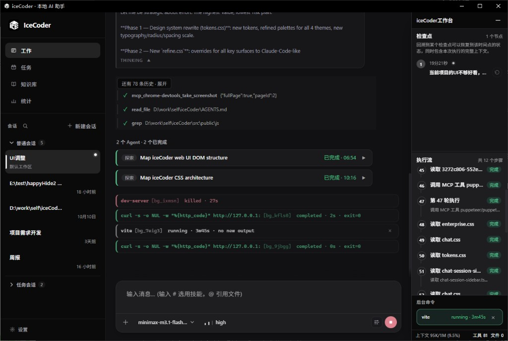
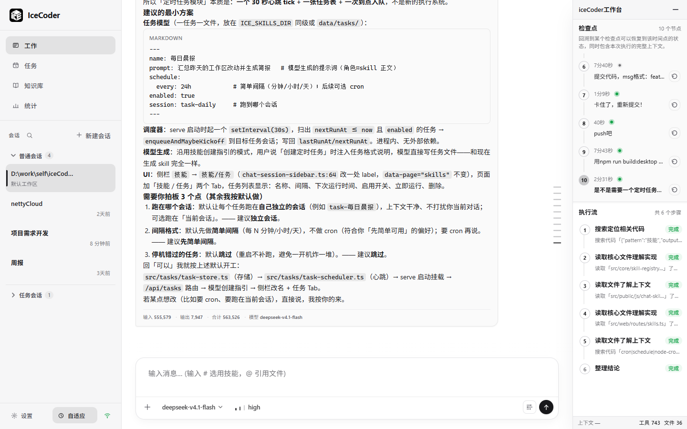
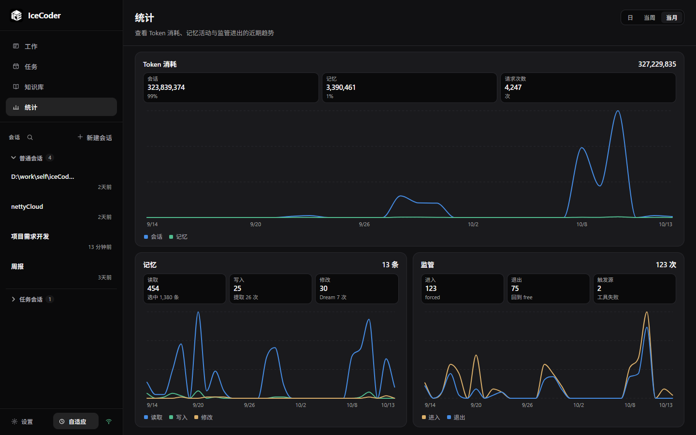
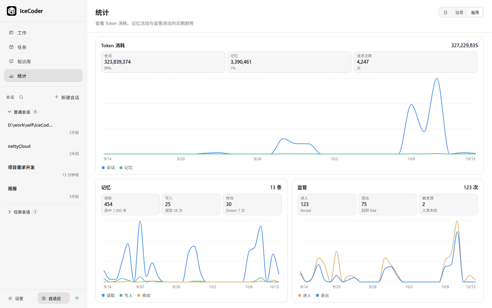
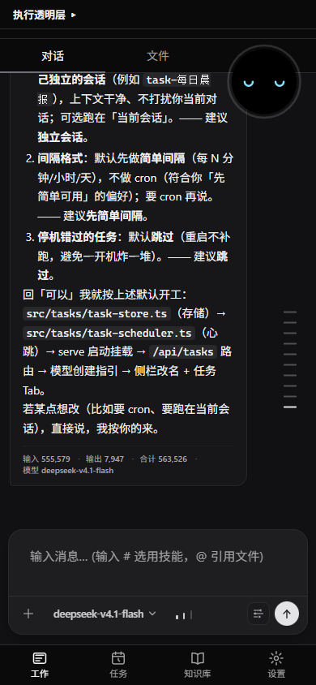
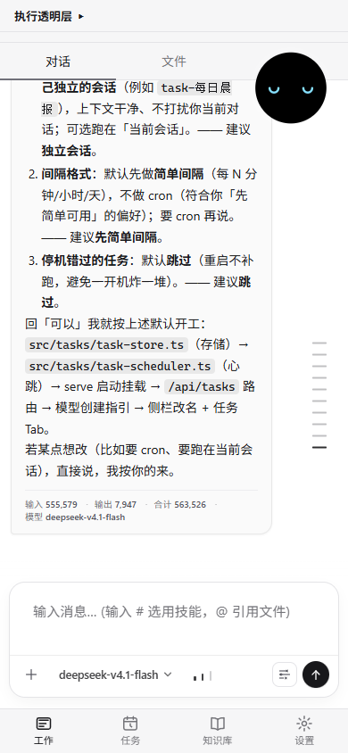
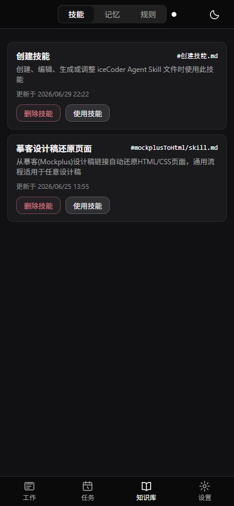
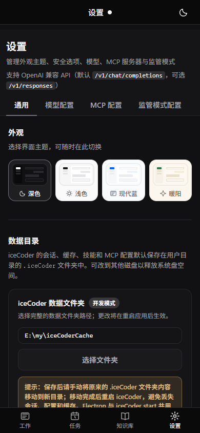
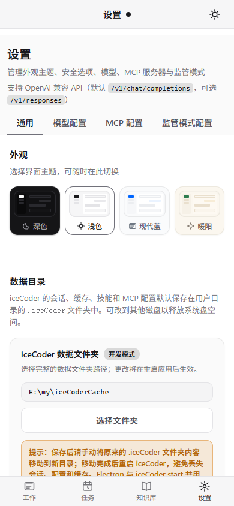

# iceCoder

**Self-hosted AI coding agent for desktop and mobile.** Single-axis supervision (L0/L1/L3), sub-agents, scheduled tasks, file memory, and MCP. One-click Windows install, or run from source / CLI on Node.js 22+.

[中文简介](./README.zh-CN.md) · [**Usage & commands**](./docs/使用文档.md) · [Full guide](./docs/PROJECT-GUIDE.md) · [项目介绍](./docs/项目介绍.md)

## Preview

### Desktop

Left nav: **Work / Tasks / Knowledge / Stats**. Footer: **Settings** and the supervision tier (off / adaptive / strict). Under Work, sessions split into **regular** and **task** groups.

**Work / chat** — transcript in the center, **iceCoder Workbench** on the right, `#` / `@` composer at the bottom with model and reasoning pickers. The workbench has no tabs: top **Checkpoints** is the per-user-turn chapter list (oldest on top; click a chapter to show its flow; ↩ on the title row rolls back). Bottom **Flow** is that chapter’s Harness rounds and short tool previews. Footer: context, tools, and changed files.





**Tasks** — `#/tasks`. A scheduled task sends its prompt, plus any attached skills, images, and files, into its own session. Schedules: interval, daily, weekly, monthly, or once. Run now, enable/disable, edit, or open the session.

**Knowledge** — tabs `#/skills`, `#/memory`, `#/rules`: skills (create, view, edit, delete), a memory graph, and global user rules.

**Stats** — token usage from a per-call JSONL ledger (session vs memory), plus memory read/write and supervisor enter/exit. Day / week / month are rolling 24h / 7d / 30d windows:





**Settings** — `#/settings` (`#/config` is the same page). Tabs: General, Models, MCP, Supervisor. General includes four themes (dark / light / modern / fresh), data directory, sub-agent toggle, workbench visibility, desktop pet, task-done notification, and mandatory shell-confirm rules.

### Mobile H5

Same bundle as desktop; routes `#/m/*`. Bottom tabs: Work / Tasks / Knowledge / Settings. A narrow `/` opens the mobile shell. Desktop and mobile themes are stored separately.

**Work** — chat detail, model and reasoning pickers, and the Ice Bean:



**Work (light theme)** — same chat layout with light appearance:



**Knowledge · Skills** — skill cards with create, edit, delete, and “Use skill”:



**Settings** — theme, data directory, and execution options:



**Settings (light theme)** — same settings with light appearance:



---

## Getting started

Pick one: Windows installer (no Node.js) or CLI tarball (Node.js 22+).

| Download | Needs | How to run |
|----------|--------|------------|
| **[Windows x64 installer](./releases/windows/iceCoder-windows.exe)** | — | Install, then launch iceCoder |
| **[CLI tgz](./releases/npm/ice-coder.tgz)** | Node.js 22+ | `npm install -g ./ice-coder.tgz` then `iceCoder start` |

Version in `package.json`: **1.0.8**.

### Windows desktop

The installer bundles the server, Electron shell, and floating Ice Bean. Configure your API key on first launch. Data directory: `~/.iceCoder/`. Settings can point it at another disk (takes effect after restart; move the old folder yourself).

**Building the desktop app from source:** run `npm run build:desktop`. On Windows, `/shell` requires rebuilding native `node-pty` for Electron — install **VS 2022 “Desktop development with C++”** plus a **Windows 10/11 SDK**. Spectre-mitigated libs are **bypassed by default** in `desktop/scripts/rebuild-server-native.cjs`. Without a C++ toolchain the rebuild is skipped (packaging still succeeds) but `/shell` will not work in the packaged app. See [`docs/使用文档.md` § Desktop build](./docs/使用文档.md#桌面打包electron) (Chinese).

### Source / Web / CLI

Install, configure API keys, start dev/Web/CLI, run one-shot tasks, tests, and coverage — **all commands are in** [`docs/使用文档.md`](./docs/使用文档.md) (not duplicated here).

Node.js **22+** (required, matches `engines.node >=22`). The repo `data/` directory holds templates only. `npm run dev` stores runtime data under `ICE_CACHE_ROOT` (code default `E:/my/iceCoderCache` when unset). The installer, `npm start`, and Electron use `~/.iceCoder/`, which Settings can move; that choice is shared with `%APPDATA%/iceCoder/data-directory.json`. Env vars: [`docs/环境变量.md`](./docs/环境变量.md).

`npm run dev` starts API **1024** and Vite **1025** (open the browser on 1025). With `PORT` unset, the source CLI defaults to API **3784**; the installer, `npm start`, and Electron default to **1024**. `VITE_PORT` changes the frontend port.

---

## Core features

### Single-axis supervisor (L0 / L1 / L3)

Three layers: **L0** is the tier in the sidebar footer (`off` / `adaptive` / `strict`); **L1** is Harness `free` ↔ `forced` with `ToolGate`, branch budget, and TaskGraph constraints when risk rises; **L3** is TaskGraph hard guard (`block` / `force_switch`, or `user_checkpoint` when no fallback).

> Legacy **L2** (takeover / PassiveObserver / CorrectionPort / EventTimeline) was removed on 2026-08-31 — see [`docs/L2监管层详解.md`](./docs/L2监管层详解.md).

- **adaptive** (default) balances freedom and enforcement; **strict** stays near forced and builds the graph on round 1 for critical engineering tasks.
- Tied to **TaskGraph** and **D′ stop-time verification** — engineering edits may run a bounded acceptance plan via `run_command`; supervision does not decide completion.
- Config: `supervisorMode` in `data/config.json` + `data/supervisor-config.json` (`mode` + `executionMode` only). The Settings “Supervisor” tab edits the same tier.
- A sub-agent’s own tier is `off` (no graph, no forced mode). The parent Verification Gate still decides whether the work is done.

### Harness loop & TaskGraph

**Harness** turns model intent into executed tools: permission rules (allow/confirm/deny), no-tool recovery, repeat-failure detection, micro/hard compaction with runtime re-injection. **TaskGraph** is the **only** structured execution context (replaces the old Execution Plan): enabled for `edit` / `debug` / `test` / `refactor`; `question` / `inspect` stay in free mode without a graph, on a lighter casual path.

- **TaskState + RepoContext** track intent, phase, touched files, and verification status.
- **CheckpointEngine v2** adds `runtimeV2` on the same `{sessionId}.checkpoint.json` (tool trail, failures, branch budget, supervisor snapshot).
- **Intent checkpoints** snapshot the workspace before each user turn. Rolling back to that turn restores files and deletes sub-agent records from that message onward.

### Sub-agents

In the default mode the parent agent calls **`task`** to run a full child Harness (compaction, recovery, permissions, and stop-time verification included). Several `task` calls in one reply run in parallel. Settings can turn this off; the tool and its prompt section are then omitted. Plan mode and Shell collaboration do not expose `task`.

| Type | What it can do |
|------|----------------|
| `general` | Read, edit, run commands, and verify one bounded piece of work |
| `explore` | Read-only search and tracing; no writes and no workspace-changing commands |

- **`run_in_background: true`** returns an agent id immediately. The parent keeps working, polls with **`check_agent`**, or receives the report on a later round.
- **Write leases** stop parallel sub-agents from editing the same file. A sub-agent cannot spawn another sub-agent, and cannot run history-changing git (`commit`, `push`, `reset`, `checkout`, and similar).
- **Chat cards** show the live tool trail and diffs, then collapse to one line. The child transcript opens read-only. Confirm dialogs name the sub-agent that asked.
- The parent context only receives `[Agent Result]`. The child transcript stays out of it.

### Three session modes

| Mode | Enter with | Behavior |
|------|------------|----------|
| **Default** | a normal message | Edit code, spawn sub-agents, create scheduled tasks |
| **Plan** | `/plan` | Refine a plan document only; no code edits and no `task` |
| **Shell collaboration** | `/shell` | The whole session is bound to one persistent PTY. The agent reads the terminal; you decide in chat. No embedded terminal window. See [Shell collaboration](./docs/shell协作模式.md) (Chinese). |

`/plan` and `/shell` stick for the session until you leave. Shell collaboration wins over plan mode.

Other `/` commands: `/also` (inject a note while a turn is running), `/next` (queue the next task quietly), `/open` (deterministic drive/directory listing; `~open` still works). The `+` button opens the `~` palette: `~scan`, `~tokens`, `~telemetry`, `~supervisor`.

### Scheduled tasks

Create them on the **Tasks** page or with the **`scheduled_task`** tool. A schedule is an interval, a daily/weekly/monthly clock time, or a single run. Each task owns a session, listed under **task sessions** in the sidebar.

Unattended runs auto-approve every tool confirmation, including deletes and dangerous commands (the page says so). Catastrophic blocks and host-process protection that never open a confirm dialog still apply. If the previous run is still going, the next tick is skipped.

### Ice Bean (Web session indicator)

Web-only Canvas pet — visual feedback from Harness / Supervisor / TaskGraph events; **does not** drive runtime decisions.

- **L0 eye color** reflects `off` / `adaptive` / `strict`.
- **L1 chip** shows `forced · …` aligned with `execution_mode_enter` reasons.
- **~20 expressions** plus a token ring.
- Minimizing the desktop window can show the same pet on the desktop. Task completion can raise a system notification. Both toggles are in Settings.

### File memory (Memory v2)

Long-term facts live as **Markdown** under `data/memory-files/` (no external vector DB). The Knowledge **Memory** tab is a graph.

- **Structured levels**: `hard_rule` / `project_fact` / `preference` / `observation` / `session_state`, plus `evidenceStrength` for ranking and eviction.
- **Intent-aware recall**: execute / inspect / question filters; conflicting same-topic memories inject **one side only**.
- **Coarse recall (pre-LLM)**: keyword pull, up to 3 snippets.
- **Extract & maintenance (post-tool)**: writes/updates after tools; **Dream** and eviction control size and conflicts.
- **Session notes** with `icecoder-runtime` blocks cooperate with Harness memory integration.
- Export is a ZIP. To import, put the Markdown files back into the memory directory.

### Agent Skills and user rules

Reusable **Markdown skill files** live under `data/skills/` (`ICE_SKILLS_DIR`).

- **Skills page**: list, preview, create a simple skill, edit, delete. Skills that ship scripts are authored in chat via the bundled “create a skill” guide.
- **Chat `#` picker**: type `#` to attach skills as chips; bodies are injected at send time.
- **User rules** (`#/rules`): global prompt text applied to every workspace and every turn, with a total character cap.
- **API**: `GET/POST/PUT/DELETE /api/skills`. Agent-written skills must stay under `ICE_SKILLS_DIR`.

### Multi-model, reasoning, and vision

Each provider can list **multiple models** in **`modelName`** (comma-separated). Switch at the bottom of the chat page; the choice is **`activeModelName`** in `data/config.json`.

- **Reasoning effort**: `reasoningEffort` is also a comma-separated list (for example `low,high,max`), switched next to the model. OpenAI-compatible APIs get `reasoning_effort`; Anthropic gets `thinking`. Empty means the field is omitted.
- **API**: OpenAI-compatible. Default path `/v1/chat/completions`, optional `/v1/responses`.
- **Provider-level `supportsVision`** (default `true`): send multimodal requests first; if the API rejects image payloads, **strip images and retry once**.
- **`supportsVision: false`**: images are stored under `imagesCache` and the model is guided to **`image_read`**. That tool does not take the strip-and-retry path.

See [`docs/使用文档.md` §配置](./docs/使用文档.md#配置) for examples.

### Multi-session, mobile H5, and cross-device sync

Sidebar **CRUD** per session — isolated history, `session-notes`, checkpoints, and per-session **workspace roots**.

- **Mobile H5**: `#/m/work`, `#/m/work/:sessionId`, `#/m/tasks`, `#/m/skills`, `#/m/memory`, `#/m/rules`, `#/m/config`.
- **`~scan`**: QR pairs phone and PC on the **same session id**.
- **runningTurn** restores an in-flight stream and sub-agent cards after refresh or reconnect.

### File references and system browser

- **`@` workspace refs**: cascade picker over the session workspace (`/api/workspace/browse`).
- **System filesystem tools**: `list_drives`, `browse_directory`, `open_file`.
- **`/open`**: server-side directory listing before the model answers (`~open` is accepted too).

### Checkpoint, compaction, and resume

Disk checkpoints bundle **task state, TaskGraph/runtimeV2, BranchBudget, supervisor snapshot**. Writes are serialized via the Harness tail.

- After **hard compaction**, TaskState + RepoContext are re-injected.
- **F5 / WS reconnect** uses `runningTurn` + checkpoint replay.
- Legacy checkpoints without `runtimeV2` remain readable.

### Tools (built-in + MCP)

Default mode ships about **30** built-in tools: file read/write/patch, `glob` / `grep`, Git, `run_command`, search and URL fetch, Office / XMind / notebook parse, system filesystem browser, `image_read`, `undo_edit`, `env_info`, plus `task`, `check_agent`, and `scheduled_task`.

Shell-collaboration sessions add `interactive_shell`, `shell_exec`, `shell_wait`, and `shell_send_keys`. **MCP** registers external server tools into the same `ToolRegistry`. MCP tools that require multi-round `input_required` are rejected with an unsupported-MRTR result.

- **Shell dual-track**: long `run_command` jobs go background, short ones stay foreground; a soft timeout can escalate.
- **Diff viewer** embeds Git-style diffs for edit tools.
- **confirm** without a UI callback defaults to **deny**. Settings can skip ordinary confirms; commands that match a mandatory shell rule still need a click. Catastrophic blocks and host-process protection always apply.
- **Lazy document tools**: parse tools are offered when the turn needs them.

### Telemetry and observability

Harness rounds, memory ops, and L1 mode changes go to `data/*/telemetry.jsonl` (`execution_mode_enter` / `exit`). Token usage is a separate JSONL ledger — that is what Stats reads. The API already splits **main vs sub-agent** (`byRole`); the page currently shows **session vs memory** only.

- Web: **`~tokens`**, **`~telemetry`**, **`~supervisor`**.
- HTTP: `GET /api/supervisor/events` returns Execution Mode enter/exit telemetry.
- Commands and paths: [`docs/使用文档.md`](./docs/使用文档.md).

### Tests and quality baseline

**410** Vitest files under `test/**/*.test.ts`, covering gates, TaskGraph, sub-agents, scheduled tasks, memory, Web routes, and parts of the UI. Case counts and coverage come from a local run — the old “~2,000 cases / ~78%” figures are retired.

- `npm test` · `npm run test:coverage` · `npm run lint`
- **`npm run eval:agent`**: agent behavior regression. `--mode=local` runs scripted file-edit cases; `--mode=mock` must not mark those cases passed. See [`docs/harness/收尾策略-模型停手与验收门控-finish.md`](./docs/harness/收尾策略-模型停手与验收门控-finish.md).
- **`npm run telemetry:runtime`**: summarize runtime telemetry JSONL.

### Local benchmarks

Archived **same-model** runs vs **Claude Code**. Scores are **SR** plus **Composite (Gate 40 + Judge 60)**. The table below is historical, not an automatic result for the current `HEAD`.

- Layers **L1–L8** (billing L4+: 97 files / 19 bugs; fusion L7: 33 probes; **L8 SaaS fusion**: multi-tenant order × supply × approval × billing).
- How to run: [`docs/使用文档.md` §本地 Benchmark](./docs/使用文档.md#本地-benchmark) · rubric [`benchMark/md/三平台同模对比评测与裁判评分体系.md`](./benchMark/md/三平台同模对比评测与裁判评分体系.md).

**Read more:** supervision → [`docs/双模机制详解.md`](./docs/双模机制详解.md) · memory → [`docs/记忆系统详解.md`](./docs/记忆系统详解.md) · compaction → [`docs/压缩机制详解.md`](./docs/压缩机制详解.md) · overview → [`docs/项目介绍.md`](./docs/项目介绍.md) · mobile H5 → [`docs/requirement/移动端H5-Shell方案-finish.md`](./docs/requirement/移动端H5-Shell方案-finish.md) · sub-agents → [`docs/requirement/多agent协同.md`](./docs/requirement/多agent协同.md)

---

## Local benchmark scores

Judge: **Cursor Composer 2.5** · Rubric: [`benchMark/md/三平台同模对比评测与裁判评分体系.md`](./benchMark/md/三平台同模对比评测与裁判评分体系.md)  
Reports: [`benchMark/reports/`](./benchMark/reports/) · Tasks: [`benchMark/tasks/`](./benchMark/tasks/) · **How to run:** [`docs/使用文档.md` §本地 Benchmark](./docs/使用文档.md#本地-benchmark)

> **Do not mix model batches** when comparing platforms (`m2.7` vs `m2.5-pro` vs `MiniMax-M3`).

| Task | Platform | Model | SR | Composite | vs CC | Duration |
|------|----------|-------|-----|-----------|-------|----------|
| [Order pipeline](./benchMark/reports/multi-file-order-pipeline.md) | iceCoder | m2.7 | ✅ | **86** | +3 | — |
| [Saga warehouse](./benchMark/reports/saga-warehouse-reconciliation-basic.md) | iceCoder | m2.7 | ✅ | **88** | +3 | — |
| [Spell Brigade](./benchMark/reports/implement-spellbrigade-survivor.md) | iceCoder / CC | m2.5-pro | 1 / 1 | **81** / **80** | +1 | ~120m / 87m |
| [Billing 19 bugs](./benchMark/reports/debug-billing-settlement.md) **01** | iceCoder | **MiniMax-M3** | ✅ 19/19 | **93** | +1 vs 02 | **≈3.6 min** · 23 turns |
| [Billing 19 bugs](./benchMark/reports/debug-billing-settlement.md) **02** | CC | **MiniMax-M3** | ✅ 19/19 | **92** | — | **5m 45s** |
| [Fusion L7 33 probes](./benchMark/reports/debug-fusion-supply-fintech.md) **01** | iceCoder | **MiniMax-M3** | ✅ 33/33 | **91** | — | **≈5.3 min** |
| [Fusion L7 33 probes](./benchMark/reports/debug-fusion-supply-fintech.md) **02** | CC | **MiniMax-M3** | ✅ 33/33 | **92** | +1 | **6m 17s** |
| [SaaS L8 fusion](./benchMark/reports/debug-saas-order-supply-approval-fusion-05.md) **01** | iceCoder | GPT-5.5 judge | ✅ 7/7 Gate | **71** | +2 vs 02 | **≈16m** · 122 turns |
| [SaaS L8 fusion](./benchMark/reports/debug-saas-order-supply-approval-fusion-05.md) **02** | CC | GPT-5.5 judge | ✅ 7/7 Gate | **69** | — | **≈5m** |

**Takeaway:** Same model + same repo — iceCoder leads on **governed delivery** (acceptance pass, composite, or wall-clock on L4+ billing); CC can win on isolated code style or raw speed. L8 both pass public Gate **38/40** with thin implementations vs the 160–220-file design target; iceCoder **+2** Composite (71 vs 69) mainly from shipping over-ship fix.

---

## Architecture (compact)

```text
CLI / Web / WS / Mobile H5
  → memory + skills + user rules
  → Harness (tools, verify, compact)
       → child Harness (task: general / explore, optional background)
  → TaskGraph → Supervisor L0/L1/L3
  → Checkpoint + write leases
  → built-in tools + MCP
```

| Piece | Role |
|-------|------|
| **Harness** | Main loop, D′ stop-time verification, compaction, telemetry |
| **Sub-agents** | `task` / `check_agent`; child Harness writes the same workspace under file leases |
| **Supervisor** | L0 tier + L1 free/forced + L3 graph hard guard |
| **TaskGraph** | Structured plan injection; it does not schedule agents |
| **File memory** | Memory v2: levels / evidence / conflict arbitration + session notes |
| **Skills / rules** | Markdown skills and global user rules |
| **Scheduled tasks** | Interval or calendar schedules, each with its own session |
| **Web / Mobile** | Pet, multi-session, H5 shell, `@`/`#` composer, diff viewer, `/` and `~` commands |

---

## Docs

| Doc | Content |
|-----|---------|
| [**使用文档**](./docs/使用文档.md) | **Commands** — install, dev, CLI, tests, benchmark |
| [**Desktop build / node-pty**](./docs/使用文档.md#桌面打包electron) | Electron packaging, VS 2022, Windows SDK (Chinese) |
| [**Shell collaboration / `/shell`**](./docs/shell协作模式.md) | Persistent PTY sessions (Chinese) |
| [**Multi-agent design**](./docs/requirement/多agent协同.md) | `task` child Harness, including custom types and worktree isolation that are not built yet |
| [PROJECT-GUIDE](./docs/PROJECT-GUIDE.md) | Architecture (some sections still describe the removed `request_analysis` path) |
| [项目介绍](./docs/项目介绍.md) | Chinese architecture notes (same caveat; prefer this README and the source) |
| [记忆系统详解](./docs/记忆系统详解.md) | Memory v2 |
| [压缩机制详解](./docs/压缩机制详解.md) | Layered compaction |
| [双模机制详解](./docs/双模机制详解.md) | L0 / L1 / L3 |
| [L2监管层详解](./docs/L2监管层详解.md) | L2 retirement note |
| [PACKAGE_USAGE](./PACKAGE_USAGE.md) | `npm pack` install |
| [Benchmark rubric](./benchMark/md/三平台同模对比评测与裁判评分体系.md) | Scoring methodology |

---

## License

MIT — see [LICENSE](./LICENSE)
