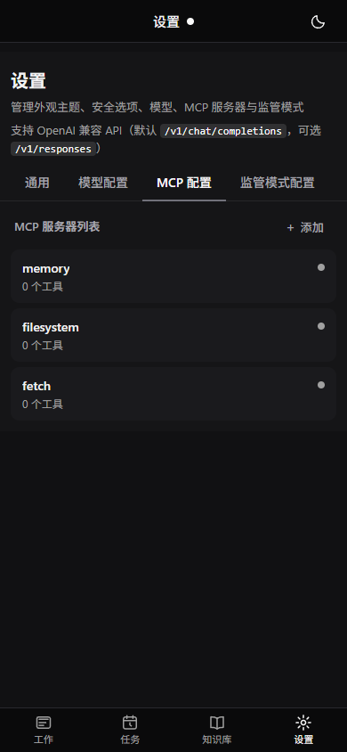

# iceCoder — Project Guide

> Full project introduction. For a quick overview, see [README](../README.md).

iceCoder is a **tool-using LLM runtime** for local repositories: a **model-led** Harness loop with tools (the model decides when to read, edit, and run commands; "think first" lives only in Plan mode), resilient **checkpoint** persistence (`CheckpointEngine` v2 on the same JSON file), file-based long-term memory, **Agent Skills**, session memory for compaction recovery, prompt assembly, and **CLI / Web / WebSocket / Mobile H5** entrypoints (plus optional MCP tools).

**Stack:** Node.js 22+, TypeScript, Express (API + static SPA in production), Vite (dev UI on a separate port), WebSocket chat, Vitest.

The goal is not only to chat with a model, but to run a **software-engineering assistant** that can understand a task, inspect a repository, edit files, run verification, recover from failures, preserve useful memory, and continue long sessions without losing state.

**Removed (no longer in tree):** the legacy **multi-stage pipeline** and per-stage **Agent** classes (`BaseAgent`, `executePipeline`, stage reports, etc.). The `Orchestrator` is now a thin holder for `FileParser` + `LLMAdapter` shared by the WebSocket chat path.

> 2026-10-16 breaking change: the three supervision tiers (off / adaptive / strict), the L1 `free` ↔ `forced` execution mode, TaskGraph, and the branch budget were removed — see [`requirement/监管收束-愿景.md`](./requirement/监管收束-愿景.md). Old `supervisorMode` values in `config.json` are ignored. The L2 takeover/observer/recovery/timeline stack was removed earlier, on 2026-08-31.

[中文项目介绍](./项目介绍.md) | [环境变量](./环境变量.md)

---

## Current Status

| Area | Status |
|------|--------|
| **Harness core** | Model-led single loop: tool execution, permissions (`allow`/`confirm`/`deny`), Task State v1, RepoContext v1, D′ stop-time verification, no-tool recovery, repeat-failure hints, all-tools-failed ladder with circuit breaker |
| **CheckpointEngine v2** | `runtimeV2` layered on the same `{sessionId}.checkpoint.json` |
| **Supervision / TaskGraph** | **Removed** on 2026-10-16 (tiers, execution mode, TaskGraph, branch budget); see [`requirement/监管收束-愿景.md`](./requirement/监管收束-愿景.md) |
| **Memory system** | File-based long-term memory + session notes + Dream/eviction; **24** test files **~446** cases — see **Memory System** · [`记忆系统详解.md`](./记忆系统详解.md) |
| **Agent Skills** | Markdown skills in `ICE_SKILLS_DIR`; Web Skills page + chat `#` injection; `/api/skills` — see **Agent Skills** |
| **Workspace & file browser** | Per-session workspace lock; `@` refs + `/api/workspace/browse`; `list_drives` / `browse_directory` / `open_file`; `~open` direct listing |
| **Mobile H5 Shell** | `#/m/*` routes; bottom tabs + session drawer; shared JS Core with desktop — see **Web app** |
| **Ice Bean (pet UI)** | Web Canvas session indicator; ~20 expressions + token ring — see **Web app** |
| **Workbench (ETL UI)** | Right-hand panel, no tabs: chapter directory (rollback on title) + selected-chapter flow; footer docks for files and tool names. Chronicle from session data (`etl-chronicle.js`). Spec: [`requirement/工作台融合-最终效果-finish.md`](./requirement/工作台融合-最终效果-finish.md) |
| **Diff Viewer** | Git-style inline diff for edit/patch tool output in Web chat |
| **Shell dual-track** | `run_command` classifier (long → background, short → foreground + soft-timeout escalate); **detached** background tasks survive Agent Stop / session switch; ETL Shell Dock + `bgTasks` WS snapshot — see **Tool Runtime** |
| **Setup gate** | Web serves config-only until valid API key; dev `./data/` vs prod `~/.iceCoder/` — see README |
| **Eval** | `npm run eval:agent` — Agent behavior regression (temp sandbox, Harness pass/fail); `--category=model-led` checks the runtime never blocks the model |

Verification:

```bash
npx tsc --noEmit
npm test
npm run eval:agent
```

Treat **`npm test`** as the source of truth. Baseline (2026-10-16): **384** test files. Full breakdown in **Testing & validation** below.

---

## Runtime Architecture

```text
User / CLI / Web / Mobile H5 / Remote
  -> loadAssembledChatPrompt()
  -> HarnessConfig
      -> ContextAssembler
      -> LLMAdapter
      -> ToolExecutor
      -> HarnessMemoryIntegration
      -> ContextCompactor
      -> TaskCheckpointManager / CheckpointEngine
  -> Harness.run()
```

### Harness Loop

The Harness is the runtime state machine around the LLM:

```text
initialize messages
initialize TaskState
initialize RepoContext
while running:
  maybe compact context
  inject runtime state and repo context
  coarse keyword memory recall (pre-LLM, up to 3 files)
  normalize messages
  call LLM with tools
  if toolCalls:
    apply permissions
    execute tools
    update TaskState / RepoContext
    inject relevant memories
    continue
  else:
    recover no-tool executable tasks
    hard state / D′ stop-time verification
    run stop hooks
    finalize
```

### Sub-agents

The model can spawn a child agent with the `task` tool (`src/harness/agents/`). `general` can read, edit, and run commands inside a write lease. `explore` is read-only. Results come back through `check_agent` or a background injection. `request_analysis`, `SubAgentRunner`, and `AnalysisSupervisor` are gone.

Key runtime protections:

- No-tool recovery for executable tasks
- D′ stop-time verification: no-tool body proposes stop; stale plan runs once via `run_command` through the same permission and execution path as ordinary tool rounds
- Permission rules before tool execution (`skipPermissionChecks` never skips an explicit deny); shell sandbox, HostGuard, workspace write boundary, missing-file preflight
- Confirmation-required tools are denied if no confirmation callback exists
- Repeated failed tool signature detection (hint only)
- All-tools-failed ladder: light hint at 2–3 rounds, failure-evidence bundle at 4–6, strong warning at 7–9, `circuit_breaker` at ≥10
- Context compaction and post-compaction Runtime Recovery Context

### Tool planner

On the first user turn of an executable engineering task, the Harness may inject a **tool planner** hint: a short list of suggested tool names derived from `taskState.intent` (see `src/harness/tool-planner.ts`). This reduces hesitant openings where the model chats instead of acting.

### Model-led loop (supervision removed)

Like Codex, Claude Code, and OpenCode, the Harness is one loop: the model decides when to read files, edit code, and run commands. The runtime does **not** switch execution tiers, build a step table, gate tools by the current step, or stop the model for editing the same file / re-running a failing command. "Analyze, write a plan, confirm, then edit" exists only in **Plan mode** (`/plan`).

Removed on 2026-10-16 (see [`requirement/监管收束-愿景.md`](./requirement/监管收束-愿景.md)): `supervisorMode` (off / adaptive / strict) and the L1 `free` ↔ `forced` execution mode, TaskGraph (step-level tool gating, `force_switch` / fallback), the branch budget (per-file edit cap, per-command retry cap), Build Diagnostic Gate, Rebuild Escalation, Runtime Self-Review hints, the "too many read-only rounds" nudge, `execution_mode_*` / `task_graph_*` events, `~supervisor`, `/api/supervisor/events`, the Settings supervision tab, and the tier-colored pet eyes. The `user_checkpoint` stop reason is kept only so old sessions still load; nothing produces it anymore.

### CheckpointEngine (Runtime Resilience v2)

`CheckpointEngine` (`src/harness/checkpoint-engine.ts`) wraps the existing **`TaskCheckpointManager`** writes for the **same** `{sessionId}.checkpoint.json` file:

- **`TaskCheckpoint`** (v1) fields remain authoritative for resumes and tooling; **`runtimeV2`** is an **additive** sibling object (recent tools, failures, verification state, verification output tail, background tasks).
- Saves on `tool_failed` / `verification_failed` / compaction / final draft, plus `step_completed` once at the end of each round. There is no forced save policy anymore.
- Older files without `runtimeV2` still load cleanly; legacy fields such as `branchBudget`, `executionModeState`, `recoverySignals`, `rebuildEscalationInjections` are dropped on read. Saves merge v1 + v2 without conflicting renames (`checkpointPersistTail` serializes writes in Harness).
- Triggers mirror the long-session design (see `docs/requirement/长时间连续工作-finish.md`).

---

## Prompt System

Prompt assembly is split into stable and dynamic layers.

### Stable System Prompt

Defined by `src/prompts/sections.ts` and assembled by `PromptAssembler`:

- identity
- work style
- execution rules
- modification rules
- tool usage policy
- shell rules
- context-management reminders

### Dynamic Context

Injected by `ContextAssembler`:

- environment
- current date
- language override if explicitly configured
- persistent memory instructions
- project instructions
- runtime state
- repo context
- memory context

This separation keeps the stable prompt cache-friendly while allowing changing runtime state to flow into the model.

中文版设计文档：[`前缀缓存优化方案`](./harness/Prompt-Caching-优化方案.md)（双轨上下文 + 封存裁剪，待实施；含实施难度、用户体验、缓存命中率、费用节约估算）。

### Tool Disable Semantics

`ICE_EVAL_MODE=1` or `ICE_DISABLE_TOOLS=1` disables runtime tools and removes tool-oriented prompt sections. This avoids the earlier split where some entrypoints removed tool instructions but still passed tools to the model.

---

## Tool Runtime

Tools are registered in `src/tools/` and exposed to the model through tool schemas.

Important components:

- `ToolRegistry`: stores available tools and definitions
- `ToolExecutor`: validates and executes tool calls with retry/timeout
- `StreamingToolExecutor`: batches and streams tool execution output
- `tool-metadata`: read-only, destructive, concurrency, and result-size metadata
- Harness permissions: runtime policy for allow/confirm/deny

Current tool categories:

- file read/write/edit/patch
- shell commands
- git
- code search
- document parsing
- web search/fetch
- environment and diff helpers

### Shell dual-track & background task lifecycle

`run_command` (`src/tools/builtin/shell-tool.ts`) uses a runtime classifier (`shell-runtime-classifier.ts`):

| Track | When | Behavior |
|-------|------|----------|
| **Background** | Long / explicit background | `BackgroundTaskManager.spawn()` or `adopt()` after foreground soft-timeout escalate |
| **Foreground** | Short commands | Runs in-process; may escalate to background after ~8s |

Each background task has an internal **`lifespan`** (not exposed in the tool schema):

| lifespan | Default | Stopped when |
|----------|---------|--------------|
| **`detached`** | yes (spawn + adopt) | App shutdown · delete/clear session · user `bg_task_stop` / `action:"stop"` · hard timeout |
| **`bound`** | reserved | Above + chat Stop · switch abort · turn abort |

Kill policy is centralized in `session-shell-control.ts`:

- **`stopForegroundShellWorkForSession`** — chat Stop, switch abort, turn abort: kills foreground shells + **bound** background only; **detached** keeps running (R1/R2).
- **`stopAllShellWorkForSession`** — delete/clear session: kills all foreground + background for that session.
- **`stopAllShellWork`** — CLI exit / server shutdown: kills everything.

Web UI (ephemeral — not written to `{sessionId}.json`):

| Surface | Role |
|---------|------|
| **`BgTaskChip`** | Chat-area chip; always updated via `bg_task_update` |
| **ETL Shell Dock** | `#etl-shell-dock-host` above ETL footer; shows **running** background tasks only (`chat-etl-shell-dock.js`) |

On WebSocket **`connected`** / **`session_switched`**, the server sends **`bgTasks`** (`buildBgTaskRunningSnapshot`) and mirrors running tasks to **`data/sessions/{sessionId}.bg-tasks.json`**. Clients hydrate the Dock via WS or **`GET /api/sessions/:id/bg-tasks`** (Desktop + Mobile share the same session file family). `BgTaskPusher` still pushes only the **active** session in real time.

Spec: [`requirement/shell-双轨执行-finish.md`](./requirement/shell-双轨执行-finish.md) · lifecycle + dock: [`requirement/shell-后台持久生命周期-ETL展示-finish.md`](./requirement/shell-后台持久生命周期-ETL展示-finish.md)

---

## Memory System

iceCoder uses **file-based** persistent memory (no external DB). Core code: `src/memory/file-memory/` (**26** source files), integrated via `HarnessMemoryIntegration` (`harness-memory.ts`).

**Full Chinese deep-dive:** [`docs/记忆系统详解.md`](./记忆系统详解.md)

### Module map

| Module | Files | Role |
|--------|-------|------|
| Storage | `file-memory-manager.ts` | Project + user memory directories |
| Scan / index | `memory-scanner.ts` · `memory-fact-index.ts` | Directory scan, FactIndex cache |
| Recall | `memory-recall.ts` | Coarse + standard recall (keyword / LLM branches) |
| Extraction | `memory-llm-extractor.ts` | Post-turn LLM memory extraction |
| Security | `memory-secret-scanner.ts` · `memory-security.ts` | Secret scan, write gates |
| Dream | `memory-dream.ts` | Periodic consolidation / dedup / prune |
| Eviction | `memory-eviction.ts` | Weighted scoring eviction (not pure LRU) |
| Session notes | `session-memory.ts` | Structured `session-notes.md` |
| Telemetry | `memory-telemetry.ts` | `data/memory/telemetry.jsonl` + HTTP report |

### Memory types

| Type | Purpose |
|---|---|
| `user` | durable user profile, role, goals, explicit preferences |
| `feedback` | corrections and behavior feedback |
| `project` | project facts not derivable from code or git |
| `reference` | links or references to external systems |

### Memory Lifecycle

```text
conversation
  -> extraction trigger
  -> LLM extraction
  -> secret scan
  -> dedup / contradiction check
  -> write memory files
  -> recall on future tasks
  -> relevance gate
  -> CoN + JSON injection
  -> dream consolidation
  -> decay / eviction
```

### Recall Flow (dual-phase)

Memory injection runs in **two phases** inside `HarnessMemoryIntegration` (`src/harness/harness-memory.ts`):

| Phase | When | LLM? | `recallPhase` telemetry |
|-------|------|------|-------------------------|
| **Coarse pre-LLM** | Before every main LLM call (`harness.ts`) | **No** — `llmAdapter` is passed as `null` | `coarse_pre_llm` |
| **Standard** | After tool rounds, before the next LLM call | **Maybe** — see gates below | `standard` |

Coarse recall returns up to **3** files via keyword/TF-IDF only (fast, ~3s typical). It does **not** set `injectedForCurrentMessage`, so standard recall can still run after tools.

Standard recall pipeline (`src/memory/file-memory/memory-recall.ts`):

```text
query
  -> scan project + user memory dirs (scanner cache)
  -> exclude alreadySurfaced paths (cross-turn dedup)
  -> confidence filter (>= 0.3)
  -> intent / level filter (execute vs inspect vs question)
  -> dedupe conflicting memories
  -> FactIndex build/cache
  -> if llmAdapter AND filtered candidates >= 2 (LLM_RECALL_MIN_CANDIDATES):
        LLM select files + rank facts (30s timeout) -> usedLLM: true
     else OR empty LLM result OR timeout/error:
        keyword fallback (TF-IDF, negation expansion, time-range boost) -> usedLLM: false
  -> related-memory expansion (1-hop, max 3)
  -> Harness: optional LLM rerank if candidates > 2 * finalK
  -> relevance gate (keyword overlap; LLM rescue if pass rate low)
  -> execution-intent filter + token budget filter
  -> CoN + JSON prompt injection
```

**Why telemetry may show 0% LLM recall:** coarse events always count as keyword; with a **small memory library**, `alreadySurfaced` often leaves **&lt; 2** candidates so the LLM branch is skipped; harness **rerank** uses LLM but does **not** set `usedLLM` on recall events. See `GET /api/memory/telemetry` and `data/memory/telemetry.jsonl`.

**Key constants:** `LLM_RECALL_MIN_CANDIDATES = 2`, `CONFIDENCE_FILTER_THRESHOLD = 0.3`, standard recall cooldown default **5 min** (`ICE_STANDARD_RECALL_COOLDOWN_SEC`, `0` disables). Remote overrides: `data/memory/memory-config.json` (hot-reloaded).

Recent changes tightened memory behavior (**Memory v2 done**):

- Recall prompt now uses strict relevance rather than broad inclusion.
- Coding/debugging tasks prefer project facts and technical constraints.
- Personal preferences are injected only when strongly relevant.
- Same-topic conflicting memories inject **one side only** (structured tags; untagged code-edit preference heuristic).
- Extraction prompt now prefers fewer high-confidence memories over noisy long-term memory.
- Weak one-off signals should remain session state, not persistent memory.
- Eval case `memory-conflict` guards against old preferences blocking current edit instructions.

### Dream Consolidation & Eviction

`src/memory/file-memory/memory-dream.ts` runs a periodic "dream" process (analogous to human sleep consolidation) that reviews, deduplicates, and prunes memories. Triggers:

- Session threshold (local default every **5** sessions; remote `minSessions` default **3** in `data/memory/memory-config.json`)
- File count threshold (default **10** files, `DEFAULT_DREAM_CONFIG.fileCountThreshold`)
- New files since last dream (≥10)
- Expired memories detected (≥3)
- Dead links in MEMORY.md index
- Memory count exceeds post-dream cap

Dream phases: **Orient** → **Gather** → **Consolidate** → **Prune**. After consolidation, the system runs a cap-enforcing eviction pass on both project-level and user-level memory directories when configured (`enforceMemoryCapAfterDream` / `enforceUserMemoryCapAfterDream`).

`src/memory/file-memory/memory-eviction.ts` implements a **weighted scoring eviction** (not pure LRU). Scores combine:

| Factor | Range | Effect |
|---|---|---|
| Freshness penalty | 0-100 | Longer inactive = higher score (more likely evicted) |
| Confidence protection | 0-30 | High confidence memories are protected |
| Recall protection | 0-20 | Frequently recalled memories are protected |
| Type protection | 0 or 15 | `user` type is protected |
| Level protection | -18 to 35 | `hard_rule` > `preference` > `project_fact` > `observation` > `session_state` |
| Evidence protection | -16 to 28 | `explicit` > `repeated` > `inferred` > `weak` |
| Source protection | 0-30 | `user_explicit` > `manual` > `dream` > `llm_extract` |
| Type evict bias | configurable | `feedback` / `reference` types biased toward eviction |

Safety protections:
- Memories with `confidence >= 1.0` are never evicted (user explicit declarations)
- Recently active memories (within `protectionDays`) are never evicted
- The `MEMORY.md` index file itself is never evicted
- Evicted files go to `evicted/` subdirectory (recoverable via `restoreEvicted()`)
- Eviction log is written to `evicted/eviction-log.jsonl`
- Old evicted archives are automatically pruned

### Memory telemetry

- **Process + JSONL:** `src/memory/file-memory/memory-telemetry.ts` writes `memory_recall` / `memory_extract` / `memory_dream` events; default log path `data/memory/telemetry.jsonl`.
- **HTTP:** `GET /api/memory/telemetry` aggregates recent days (LLM vs keyword recall rate, extract cache hits, Dream stats, store file counts).
- **Recall metrics:** `usedLLM` reflects only `recallRelevantMemories()` — not harness rerank or relevance-gate rescue LLM calls.

### Memory tests

| Type | Files | Cases (~) | Coverage |
|------|-------|-----------|----------|
| Unit / integration | **24** | **~446** | recall, extract, Dream, eviction, security, concurrency |
| E2E | included | **9** in `memory-e2e.test.ts` | extract → write → recall |

Command: `npm test -- test/memory/` · Design: [`docs/记忆系统详解.md`](./记忆系统详解.md) · changelog: [`docs/requirement/记忆系统调整-finish.md`](./requirement/记忆系统调整-finish.md)

---

## Session Memory and Compaction

Long sessions use session memory and context compaction to avoid losing current task state.

### Session Memory

`session-memory.ts` maintains a structured Markdown session note with sections such as:

- Session Title
- Current State
- Task Specification
- Files and Functions
- Workflow
- Errors & Corrections
- Worklog

Recent changes:

- forced session memory update is supported before compaction
- session memory update prompt now asks the LLM to return Markdown directly
- code validates returned notes before writing

### Context Compaction

`ContextCompactor` uses layered compression (deep dive: [`docs/压缩机制详解.md`](./压缩机制详解.md)):

1. snip duplicate reminders/summaries
2. microcompact old low-value history
3. trim long tool results
4. extract structural summary
5. optionally refine summary with LLM
6. re-inject recent file content and recovery prompt

Watermarks (relative to context window): **~80%** micro · **~88%** hard · remaining **&lt;18K** also hard · **~93%** aggressive fork.

The context window is selected by priority:

```text
ICE_CONTEXT_WINDOW
  -> default provider maxContextTokens
  -> largest configured provider maxContextTokens
  -> 128k default
```

### Runtime snapshot in session notes

Structured **`TaskState`** and **`RepoContext`** can be persisted into `data/sessions/session-notes.md` inside a fenced block with language tag **`icecoder-runtime`** (JSON payload). Schema types live in **`src/types/runtime-snapshot.ts`** (`PersistedRuntimeV1`, etc.) so session-memory does not depend on harness implementation classes.

When a chat session **resumes with existing message history**, the Harness can **`applySnapshot`** from that block so process restarts or UI reloads still restore goal, phase, files touched, and verification status—not only narrative session notes.

---

## Task State and Repo Context

Task State v1 and RepoContext v1 are the current bridge toward a stronger **tool-using** runtime with clearer state and verification.

Task State tracks:

- goal
- intent
- phase
- files read
- files changed
- commands run
- whether verification is required
- verification status

RepoContext tracks:

- files read
- files changed
- commands run
- test commands
- recent diagnostics

Once useful state exists, Harness injects it as runtime context before LLM calls.

This gives the model a stable view of what has happened even if conversation history grows or is compacted.

---

---

## Testing & validation

### Automated tests (Vitest)

**Baseline (2026-10-16):** **384** test files under `test/**/*.test.ts` (dedicated supervision / TaskGraph / branch-budget suites and the dual-mode e2e were deleted with those features). Case counts and coverage come from a local run.

| Directory | Files | Notes |
|-----------|-------|-------|
| `test/harness/` | **106** | Harness loop, permissions, failure ladder, stop-time verification, compaction, checkpoint, Shell dual-track |
| `test/web/` | **57** | API, sessions, setup gate, workspace browse, skills, chat-ws |
| `test/tools/` | **44** | Shell classifier / sandbox, background tasks, git, patch, parsers, Windows tools |
| `test/public/` | **42** | Ice Bean, workbench, chat page, stats page, diff viewer |
| `test/memory/` | **30** | File memory recall / extract / Dream / eviction |
| `test/llm/` | **23** | Adapters, token counting |
| `test/eval/` | **13** | Agent eval sandbox (including scripted `model-led` cases) |
| Other | **69** | cli, mcp, session, desktop, config, prompts, parser, core, … |

```bash
npx tsc --noEmit
npm test
npm test -- test/memory/
npm test -- test/harness/harness.test.ts
npm test -- test/eval/agent-eval-sandbox.test.ts   # scripted eval cases, offline
```

### Release gate

1. `npx tsc --noEmit` — 0 errors  
2. `npm test` — all green (default config)  
3. `npm run eval:agent -- --mode=local` — scripted cases pass (including `model-led`)

---

## Runtime evaluation (eval harness)

**Agent Eval Runner** (`npm run eval:agent`, `scripts/agent-eval.ts`):

```bash
npm run eval:agent                              # default real — configured LLM required
npm run eval:agent -- --mode=mock               # no-API smoke; scripted local cases still run for real
npm run eval:agent -- --mode=local              # scriptedTurns only: isolated workspace + real tools
npm run eval:agent -- --case=single-file-edit   # comma-separated ids allowed
npm run eval:agent -- --category=model-led      # one category only
npm run eval:agent -- --format=markdown --keep-workspaces
```

- Case definitions: `scripts/agent-eval-cases.ts` (catalog + `stop-verification` local-edit cases + `model-led` cases).
- `model-led`: scripted `model-led-same-file-five-edits`, `model-led-rerun-failing-command`, `model-led-long-read-only-exploration` (also run offline in `test/eval/agent-eval-sandbox.test.ts`), plus real-model `model-led-real-incremental-functions` and `model-led-real-read-chain`.
- Every case additionally fails on any supervision text (`[BranchBudget`, `[ToolGate]`, `[TaskGraph]`, `[Runtime Self-Review]`, `Rebuild Escalation`, `Diagnostic Gate`, `Current branch exhausted`, `reading/analyzing for`) or any `execution_mode_*` / `task_graph_*` event. Each report includes a behavior table (rounds, LLM calls, tool calls, failures, blocks, writes, max writes to one file, `run_command` count, tokens, duration, stop reason).
- Runner: `scripts/agent-eval-runner.ts` — `mkdtemp` sandbox, `initializeToolSystem`, `Harness.run`, file/command judges. Cases with `scriptedTurns` must not be fake-passed by mock metrics.
- History: `data/eval/agent-eval-history.jsonl`.
- Non-zero exit when any case fails or P0 metrics regress.
- Stop-time verification design: [`harness/收尾策略-模型停手与验收门控-finish.md`](./harness/收尾策略-模型停手与验收门控-finish.md).

Metrics per case and aggregate:

- task_success_rate
- tool_call_rate
- first_tool_latency
- no_tool_final_rate
- verification_rate
- repeat_failure_rate
- memory_interference_rate
- tokens_per_successful_task
- compaction_saved_tokens
- compaction_recovery_success_rate (`compression-recovery` only; requires hard compaction + post-compaction tool progress + verification)


---

## Web app, API, and ports

- **HTTP server** (`src/index.ts`, `src/web/server.ts`): default port **`1024`** when started via `tsx src/index.ts` / `npm run dev -- --api`. Serves the built SPA static assets in production; in development it still hosts API routes while the Vite dev server serves the UI.
- **CLI `web` / `start` / `chat`**: default port **`3784`** unless `PORT` or `--port` is set (`src/cli/commands/serve.ts`, `chat.ts`).
- **Vite dev UI** (`vite.config.ts`): default **`1025`**, proxies `/api` and WebSocket upgrade to `http://localhost:1024`.
- **WebSocket chat**: attached to the HTTP server (`src/web/chat-ws.ts`); mobile/remote clients use `/api/remote` and related routes.
- **Desktop routes**: `#/chat`, `#/tasks`, `#/skills`, `#/memory`, `#/rules`, `#/stats`, `#/settings` — left nav: Work / Tasks / Knowledge / Stats.
- **Mobile H5 routes**: `#/m/work`, `#/m/work/:sessionId`, `#/m/tasks`, `#/m/skills`, `#/m/memory`, `#/m/rules`, `#/m/config` — bottom tabs: Work / Tasks / Knowledge / Settings (`src/public/js/shell/mobile-shell.ts`).
- **Notable API mounts**: `/api/config`, `/api/tools`, `/api/remote`, `/api/sessions`, `/api/skills`, `/api/workspace/browse`, `/api/chat/upload`, `/api/memory/*` (telemetry report, file CRUD, recall test/export).
- **Frontend** lives under `src/public/` (chat UI, Skills/Memory pages, Ice Bean, mobile pages). Production build output: `dist/public/`.

LLM provider settings are read from **`data/config.json`** by default (see `data/config.example.json`). The server can **watch** that file and reload providers without a full restart (`src/index.ts`).

**Multi-model:** `modelName` accepts comma-separated model ids; `activeModelName` is the one used for API calls and shown in the chat picker. **Vision:** per-provider `supportsVision` (default `true`) — multimodal first, then `LLMAdapter` strips images and retries on API rejection (`src/llm/vision-fallback.ts`); set `supportsVision: false` to route pasted images through `image_read` paths instead. **Extra HTTP headers:** optional per-provider `headers` (literals or `{{sessionId}}` / `{{providerId}}` / `{{model}}`).

### UI screenshots

Full gallery: [README § Preview](../README.md#preview) · [README.zh-CN § 界面预览](../README.zh-CN.md#界面预览).

**Desktop**


**Mobile H5**




### Ice Bean (session pet / Web indicator)

The **chat page** embeds **Ice Bean** (display name **冰豆**, `SESSION_PET_DISPLAY_NAME`): a Canvas-based indicator mapping Harness runtime state to **expressions, bubbles, and a token ring** — decoupled from backend logic.

**Architecture**

```text
WebSocket HarnessStepEvent
  → chat-page.js
  → ChatPetBridge (chat-pet-bridge.js)
       ├─ SessionPet (session-pet.js)        Canvas render · expression FSM
       ├─ session-pet-palette.js             Fixed eye color / ring colors
       └─ ChatExecutionPlan                  workbench chapters / flow
```

| | |
|---|---|
| **Look** | ~120×120 px; fixed eye color (`SESSION_PET_EYE_COLOR`), no longer tied to a supervision tier |
| **Token ring** | Context usage arc (green → yellow → red) via `eyeColorForTokenPct()` |
| **Bubbles** | Harness events: tool call, failure, pending confirm, compaction, circuit breaker, done |
| **Expressions** | ~**20** states (thinking, tools, memory, MCP, tunnel, etc.) |
| **Interaction** | Drag (`localStorage` `ice-session-pet-position`) · double-click reset · `aria-label` |
| **Sources** | `session-pet.js` · `session-pet-palette.js` · `chat-pet-bridge.js` · `style.css` |
| **Demo** | `pet-expressions-demo.html` — manual expression QA |
| **Tests** | **2** files · **12** cases: `session-pet-palette.test.ts` · `session-pet-expression-cycle.test.ts` |

CLI-only workflows have **no Ice Bean**; it is a browser UX layer only.

### Agent Skills

Skills are **Markdown playbooks** stored only under **`ICE_SKILLS_DIR`** (default `{dataDir}/skills`, set in `src/cli/paths.ts`).

| Layer | Role |
|-------|------|
| **`src/skills/skill-loader.ts`** | Scan root `.md` + one-level `folder/skill.md`; parse frontmatter; `#` ref parsing |
| **`src/core/skill-registry.ts`** | Disk + builtin registry; `resolveMessage()` injects bodies; creation-guide when user asks to author skills |
| **`src/web/routes/skills.ts`** | `GET/DELETE /api/skills` |
| **`src/public/js/skills-page.js`** | Desktop Skills tab UI |
| **`src/public/js/chat-skills.js`** | Composer `#` dropdown + chip bar |

Chat send path (`chat-ws.ts`) resolves `#skill.md` references before Harness runs. Bundled template: `data/skills/创建技能.md` (copied on first install).

### Workspace references & system filesystem browser

| Feature | Implementation |
|---------|----------------|
| **Per-session workspace** | `{sessionId}.workspace.json` via `session-workspace-store.ts`; exposed on `/api/sessions` |
| **`@` file refs** | `chat-file-ref.js` + `GET /api/workspace/browse` (`workspace-browse.ts`) |
| **System browser tools** | `list_drives`, `browse_directory`, `open_file` in `filesystem-browser-tool.ts` — paths outside repo/workdir |
| **`~open` direct listing** | `file-browser-direct.ts` executes real `browse_directory` server-side before LLM answers |

Uploads and paste images remain in `chat-file.js` (`/api/chat/upload`).

### Mobile H5 Shell

Same `index.html` / `main.js` bundle as desktop. Route prefix **`#/m/`** selects `MobileShell` instead of the left sidebar.

| Route | Page |
|-------|------|
| `#/m/work` | Dashboard + composer + session drawer |
| `#/m/work/:sessionId` | Full-screen chat (对话 / 文件 / 技能 sub-tabs) |
| `#/m/memory` | Memory wrapper |
| `#/m/skills` | Skills wrapper |
| `#/m/config` | Config + setup gate |

Core modules (`chat-session-store.js`, `chat-websocket.js`, `chat-skills.js`, etc.) are shared; only shell DOM differs. Spec: [`requirement/移动端H5-Shell方案.md`](./requirement/移动端H5-Shell方案.md).

---

## MCP (Model Context Protocol)

`src/mcp/mcp-manager.ts` reads **`mcpServers`** from **`.iceCoder/mcp.json`** under the current working directory (override with **`ICE_MCP_CONFIG_PATH`**). Shape matches common MCP configs: top-level `mcpServers` object. When a server starts successfully, its tools are **registered into the main `ToolRegistry`** alongside builtins (prefixed `mcp_{serverName}_{toolName}`). Failures are logged but do not block core startup. See **`.iceCoder/mcp.example.json`** for a template. CLI: `iceCoder mcp` for status.

**Note:** LLM provider settings stay in `data/config.json` (or `ICE_CONFIG_PATH`); MCP is intentionally separate.

---

## Configuration and environment variables

Full documentation for **every** process environment variable and the browser `localStorage` key (purpose, valid values, defaults, code locations, `.env` template):

**[`docs/环境变量.md`](./环境变量.md)** — full reference (Chinese)

Quick reference:

| Variable | Role | Default | Valid values |
|----------|------|---------|--------------|
| `ICE_DATA_DIR` | CLI data root | `./data` or `~/.iceCoder` | directory path |
| `ICE_CONFIG_PATH` | LLM provider config | `{dataDir}/config.json` | file path |
| `ICE_SKILLS_DIR` | Agent skill Markdown files | `{dataDir}/skills` | directory path |
| `PORT` | HTTP port | CLI **3784** / `index.ts` **1024** | port number |
| `ICE_CONTEXT_WINDOW` | Context token cap | provider → **128000** | positive integer |
| `ICE_EVAL_MODE` | Eval mode (skip extraction, etc.) | off | `1` |
| `ICE_MCP_CONFIG_PATH` | MCP config | `<cwd>/.iceCoder/mcp.json` | file path |

**40+** process variables total. Removed vars (`ICE_HARNESS_TOKEN_BUDGET`, `ICE_HARNESS_TIMEOUT_*`, `ICE_SUPERVISOR_CONFIG_PATH`, `ICE_TASK_GRAPH`, etc.) are listed in the doc. Browser `ICE_PLAN_PANEL=0` in `localStorage` hides the execution workbench.

---

## Repository layout (concise)

```text
src/
  cli/              # CLI entry, bootstrap, commands (web, run, config, mcp, …)
  core/             # Orchestrator (shared file parser + LLM adapter)
  harness/          # Harness, compaction, task/repo state, D′ stop-time verification,
                    # checkpoint + CheckpointEngine v2
  llm/              # OpenAI-compatible + Anthropic Messages adapters
  memory/file-memory/  # File-based memory (26 modules), session notes, dream, eviction
  skills/             # skill-loader, SkillRegistry helpers
  parser/           # FileParser strategies (HTML, Office, XMind)
  prompts/          # Prompt assembly
  tools/            # Builtin tools (incl. filesystem browser), registry, executor
  mcp/              # MCP client manager
  web/              # Express server, routes, WebSocket chat, workspace browse
  public/           # Vite root: chat UI, Skills/Memory pages, mobile shell, Ice Bean
  types/            # Shared types (runtime snapshot, runtime-checkpoint schema)
docs/               # Requirements archives, memory benchmarks, historical supervision specs
test/               # Vitest suites mirroring src areas
data/               # Provider config templates, sessions, optional MCP-side memory sample
```

---

## Development

```bash
npm install
npm test
npx tsc --noEmit
npm run eval:agent
```

Common commands:

```bash
npm run dev                 # API + Vite (+ tunnel unless --no-tunnel)
npm run dev -- --api        # API only (tsx src/index.ts)
npm run dev -- --web        # Vite only (port 1025)
npx tsx src/cli/index.ts web --port 1024
npx tsx src/cli/index.ts run "fix failing tests"
npm run telemetry:runtime
```

Global CLI after `npm link` / global install: `iceCoder` → `dist/cli/index.js` (see `package.json` `bin`).

---

## Design documentation

Higher-level prose (beyond this README):

- [`docs/环境变量.md`](./环境变量.md) — **full environment variable reference** (purpose, valid values, defaults)
- [`docs/记忆系统详解.md`](./记忆系统详解.md) — Memory v2 design (no vector DB)
- [`docs/压缩机制详解.md`](./压缩机制详解.md) — layered compaction + structured recovery
- [`docs/requirement/监管收束-愿景.md`](./requirement/监管收束-愿景.md) — why supervision tiers / TaskGraph / branch budget were removed
- [`docs/双模机制详解.md`](./双模机制详解.md) — **historical**: L0 / L1 / L3 single-axis supervisor (removed 2026-10-16)
- [`docs/L2监管层详解.md`](./L2监管层详解.md) — **historical**: retired L2 migration note
- [`docs/requirement/任务图规划-finish.md`](./requirement/任务图规划-finish.md) — **historical**: TaskGraph / StepGraph design (removed 2026-10-16)
- [`docs/requirement/执行透明-finish.md`](./requirement/执行透明-finish.md) — legacy Execution Transparency Layer (the **UI panel** is now the workbench)
- [`docs/requirement/执行流-最终效果-finish.md`](./requirement/执行流-最终效果-finish.md) — chronicle data meaning (chapter = user turn)
- [`docs/requirement/工作台融合-最终效果-finish.md`](./requirement/工作台融合-最终效果-finish.md) — **current** workbench UI (no tabs; aligned to 2026-09-14 code)
- [`docs/requirement/长时间连续工作-finish.md`](./requirement/长时间连续工作-finish.md) — long sessions & checkpoint triggers
- [`docs/requirement/记忆系统调整-finish.md`](./requirement/记忆系统调整-finish.md) — memory system adjustments (changelog)
- [`docs/requirement/L2测试过程.md`](./requirement/L2测试过程.md) — **historical**: dual-mode test playbook (features removed)
- [`docs/requirement/双模方案2-finish.md`](./requirement/双模方案2-finish.md) — **historical**: dual-mode supervisor spec V1.3.7 (removed)
- [`docs/requirement/运行时后续优化.md`](./requirement/运行时后续优化.md) — Phase **5E** follow-up (benchmark / Learning; deferred)
- [`docs/locomo/memory-optimization-roadmap.md`](./locomo/memory-optimization-roadmap.md) — memory benchmark & recall tuning notes

---
